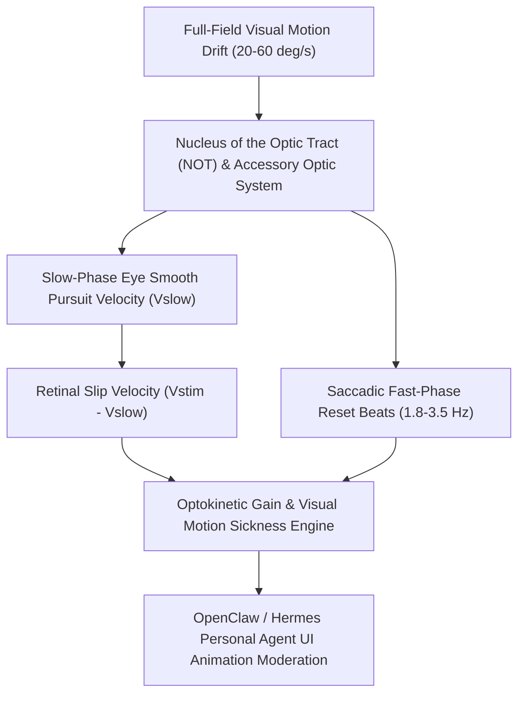

# Ocular Optokinetic Nystagmus (OKN) Skill

[](LICENSE)
[](https://www.python.org/)
[](requirements.txt)
[](mcp_server.py)
[](SKILL.md)

Zero-dependency sovereign personal agent skill for non-invasive evaluation of Optokinetic Nystagmus (OKN) slow-phase velocity gain, retinal slip velocity, and visual-vestibular motion stabilization.



## Features
- **Deterministic Math**: Pure Python standard library implementation with zero external dependencies.
- **Visual Neurophysiology Standards**: Formulates OKN slow-phase gain, retinal slip speed, and directional symmetry ratios.
- **Screen Vertigo & Simulator Sickness Shield**: Detects early breakdown of wide-field visual tracking during rapid desktop screen interaction.
- **Model Context Protocol (MCP)**: Native JSON-RPC tool integration for LLMs and autonomous agents.

## Quickstart

```python
from client import OcularOptokineticNystagmusClient

client = OcularOptokineticNystagmusClient()
result = client.evaluate_okn(
    stimulus_velocity_deg_s=30.0,
    slow_phase_velocity_deg_s=27.2,
    fast_phase_frequency_hz=2.6
)
print("OKN Gain:", result["okn_gain"])
print("Optokinetic Score:", result["optokinetic_score"])
print("Classification:", result["classification"])
```

## License
Apache-2.0
